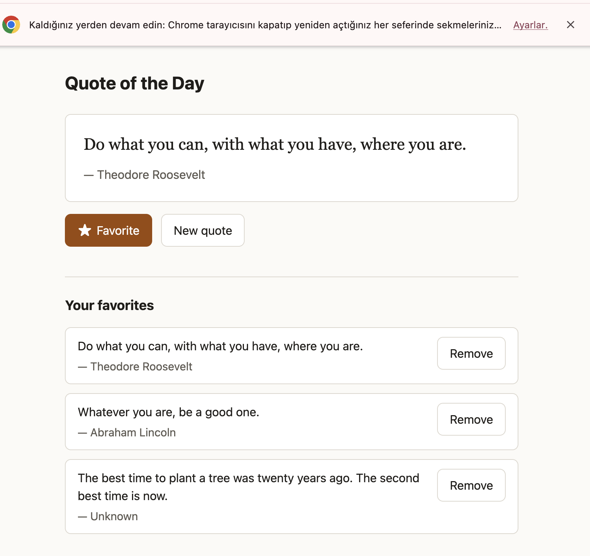
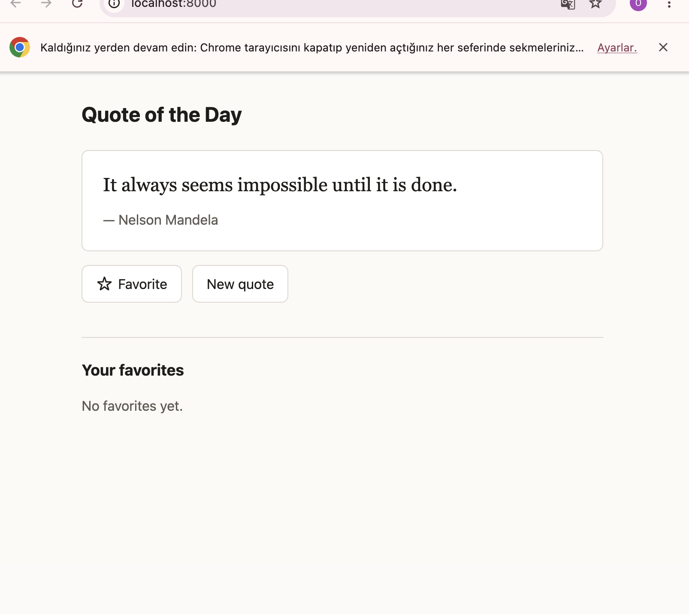

# Week 2 — Spec-Driven Development with Spec Kit: Writeup

- **Agent:** Claude Code 2.1.292 (Spec Kit integration key `claude`)
- **Spec Kit:** specify-cli 1.1.1, initialized with `specify init spec-kit-week2 --integration claude --script sh`
- **Feature:** Quote of the day page: a random quote, a "New quote" button, and favorites saved in `localStorage`
- **Run it:** `npm install`, then `npm run serve`, then open http://localhost:8000. Tests: `npm test`.

## 1. Prompts given to each skill

| Step | Prompt | Artifact (commit) |
|---|---|---|
| Constitution | `/speckit-constitution Create principles focused on code quality, testing, and maintainability.` | `.specify/memory/constitution.md` (`d827059`) |
| Specify | `/speckit-specify A quote-of-the-day page: one random quote from a built-in list, a "New quote" button, and favoriting that persists across reloads.` | `specs/001-quote-of-the-day/spec.md` (`2357851`) |
| Clarify (refinement) | `/speckit-clarify Favorites need to be visible: add a simple list of all favorited quotes below the current quote, where each can be unfavorited. Update the spec's assumptions and requirements accordingly.` | `spec.md` updated (`c3d90c8`) |
| Plan | `/speckit-plan Use plain HTML/CSS/JavaScript, no backend; persist favorites in localStorage.` | `plan.md`, `research.md`, `data-model.md`, `contracts/`, `quickstart.md` (`328e960`) |
| Tasks | `/speckit-tasks` | `tasks.md`, 38 tasks, tests first in every story (`704d198`) |
| Implement | `/speckit-implement` | `index.html`, `src/`, `tests/` (`2112449`) |
| Converge, round 1 | `/speckit-converge` | 4 findings added as T039–T042 (`f3f5896`) |
| Implement | `/speckit-implement` | T039–T042 fixed (`271a88a`) |
| Converge, round 2 | `/speckit-converge` | **Converged**, 0 findings |

I also ran `/speckit-taskstoissues` by mistake instead of `/speckit-tasks`. It stopped without changing anything, because `tasks.md` and a GitHub remote did not exist yet.

## 2. Refining the spec: before and after

**What was wrong.** The first `spec.md` let the visitor favorite a quote, but under Assumptions it put a list of favorites out of scope: *"The visitor sees favorite status on the displayed quote only; browsing a list of all favorites ... [is] not part of this feature."* With no list, a visitor could only see a favorite again if the random draw happened to show that quote again. The favorite feature was close to useless.

**What I changed.** I fixed the **spec**, not the code, with `/speckit-clarify` (prompt above).

| | Before (`2357851`) | After (`c3d90c8`) |
|---|---|---|
| Assumption | "Favorites list is out of scope for v1" | "Favorites list is simple": the full list, newest first, with an unfavorite control on each entry |
| User stories | US1–US3 | + **US4 "See and manage all favorites"** with 5 acceptance scenarios |
| Requirements | FR-001 to FR-012 | + **FR-013 to FR-017**: the list sits below the quote, each entry has a Remove control, the list stays in sync with the main favorite button, an empty-list message, and keyboard focus is handled after a removal |
| Success criteria | SC-001 to SC-007 | SC-007 updated, + SC-008 and SC-009 |

`git diff 2357851 c3d90c8 -- specs/001-quote-of-the-day/spec.md`: 68 lines added, 7 removed.

**How the output changed.** The refinement carried through every later artifact. `plan.md` and `contracts/ui.md` describe a favorites section. `tasks.md` has Phase 6 (US4, T032–T035), and the page shows a **"Your favorites"** list:

With no favorites, the list shows its empty message:

Without the refinement, none of this would have been built.

## 3. Convergence outcome

**Round 1: not converged.** The code met all 17 functional requirements and all 21 acceptance scenarios. The constitution check found 4 problems:

| Task | Severity | Finding | Fix |
|---|---|---|---|
| T039 | CRITICAL (constitution MUST) | `storage.js` and `favorites.js` swallowed exceptions silently (Principle V) | Each `catch` now logs a `console.warn` with context. Tests were written first. |
| T040 | CRITICAL (constitution MUST) | Three tests used unseeded `Math.random` (Principle III). The agent said this started in the task text it wrote itself (T018/T019). | Fixed-seed generator `seededRng(42)` |
| T041 | MEDIUM | US4 tests selected elements by CSS class, which is not part of the UI contract | Tests read entries in the contract format `<text> — <author>` |
| T042 | MEDIUM | `mountApp` was 133 lines (guideline ~40) | Split into small functions, behavior unchanged |

**Round 2: ✅ Converged.** 0 findings in every category. ESLint 0 warnings, Prettier clean, **75/75 tests**, 100% line coverage.

**Manual browser checks (T038).** In Chrome I checked: new quote, favorite and unfavorite, favorites kept after reload, Remove from the list, the empty-list message, 360 px width with no horizontal scroll ([screenshot](docs/mobile-360.png)), and an incognito window. I did not check VoiceOver, manually corrupted storage, or Safari.

**Observations while reviewing:**
- The constitution was heavy for a single static page: it requires CI and reviewer approval. The plan's Constitution Check still marked everything ✅, even though the plan has no CI workflow and a solo project has no reviewer. The agent's self-check was too optimistic.
- The plan avoided a build step and runtime dependencies. Its dev-only tools (Node's test runner, ESLint, Prettier and jsdom) were a reasonable middle ground.

## 4. What I learned

The six documents written before any code felt long, but they paid off. Because I caught the missing favorites list at the spec stage, I did not have to revise the code later, which would have made the process take longer. During planning the agent marked every check as passing, yet converge still found four issues; I think this kind of thing can happen in code. What matters is moving forward step by step with a modular structure: if the architecture is set up properly, it is easier to see errors and fix them.

